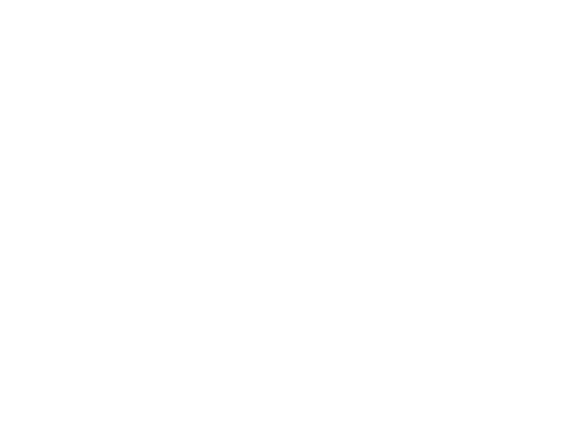
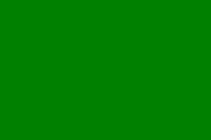
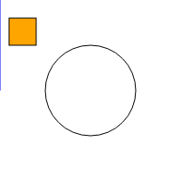
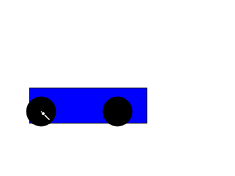
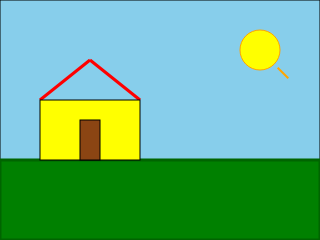
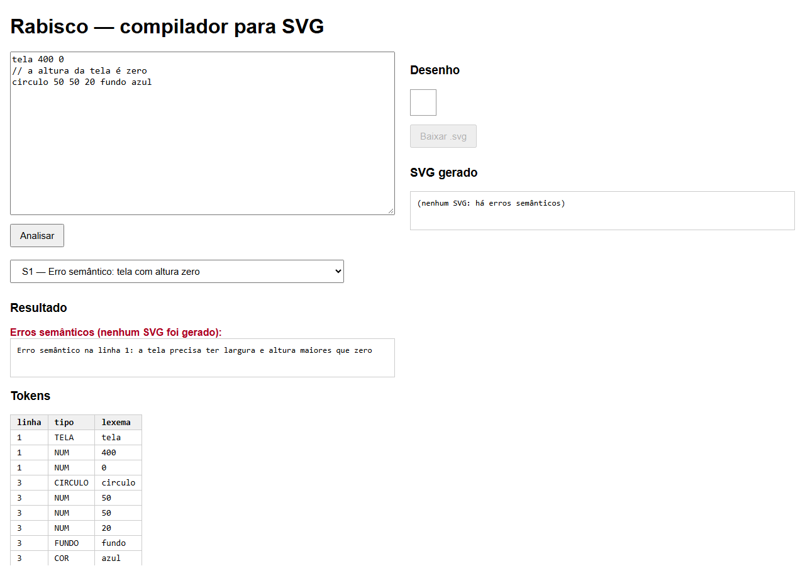
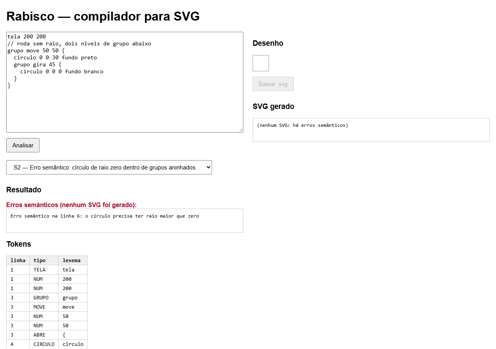
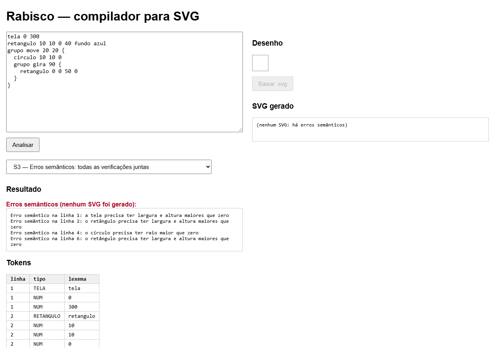
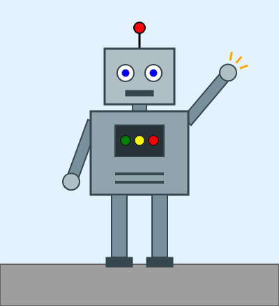

# Casos de teste — Rabisco (Fase 2)

Gerado a partir de `casos.js` por `node ferramentas/casos-md.mjs`. Para conferir tudo: `node testes.mjs`
(grava os SVGs em `testes/svg/`); as imagens são geradas por `node ferramentas/imagens.mjs`.

| Grupo | Casos | Resultado esperado |
|-------|-------|--------------------|
| Válidos da Fase 1 | V1–V5 | SVG em `testes/svg/` e imagem em `testes/png/` |
| Erro semântico | S1–S3 | lista de erros com a linha; nenhum SVG (captura da página em `testes/pagina/`) |
| Inválidos da Fase 1 | I1–I3 | erro léxico ou sintático (as fases seguintes não rodam) |
| Desenho final | D1 | `desenho-final/robo.svg` e `robo.png` |

## V1 — Programa mínimo (só a tela)

**Cobre:** tela obrigatória, comentário, programa sem nenhuma forma.

**Programa:**

```
tela 800 600
// programa mínimo: só a tela, nenhuma forma
```

**Resultado:** programa válido. SVG gerado (`testes/svg/V1.svg`):

```svg
<svg xmlns="http://www.w3.org/2000/svg" width="800" height="600" viewBox="0 0 800 600">
</svg>
```



## V2 — Três formas e todos os atributos

**Cobre:** reta, círculo, retângulo; borda, fundo e espessura em ordens diferentes; cores por nome e hexadecimal; zero (onde é permitido: coordenadas e espessura); atributo repetido (vale o último).

**Observação:** Na Fase 1 o segundo círculo tinha raio 0. Na Fase 2 isso é erro semântico, então o raio passou a 15.

**Programa:**

```
tela 300 200
// as três formas, com atributos em ordens diferentes
reta 10 10 290 10
reta 10 20 290 20 borda vermelho
reta 10 30 290 30 espessura 4 borda #00FF7F
circulo 60 100 40 fundo amarelo borda preto espessura 3
circulo 150 100 15
retangulo 200 80 80 60 fundo roxo
retangulo 0 0 300 200 espessura 0 fundo azul fundo verde
```

**Resultado:** programa válido. SVG gerado (`testes/svg/V2.svg`):

```svg
<svg xmlns="http://www.w3.org/2000/svg" width="300" height="200" viewBox="0 0 300 200">
  <line x1="10" y1="10" x2="290" y2="10" fill="none" stroke="black" stroke-width="1"/>
  <line x1="10" y1="20" x2="290" y2="20" fill="none" stroke="red" stroke-width="1"/>
  <line x1="10" y1="30" x2="290" y2="30" fill="none" stroke="#00FF7F" stroke-width="4"/>
  <circle cx="60" cy="100" r="40" fill="yellow" stroke="black" stroke-width="3"/>
  <circle cx="150" cy="100" r="15" fill="none" stroke="black" stroke-width="1"/>
  <rect x="200" y="80" width="80" height="60" fill="purple" stroke="black" stroke-width="1"/>
  <rect x="0" y="0" width="300" height="200" fill="green" stroke="black" stroke-width="0"/>
</svg>
```



## V3 — Grupos e modificadores

**Cobre:** grupo sem modificador, com gira, com move, com os dois em ordens misturadas, modificador repetido e grupo vazio.

**Programa:**

```
tela 200 200
grupo {
  circulo 100 100 50
}
grupo gira 90 {
  reta 0 0 100 0 borda azul
}
grupo move 10 20 {
  retangulo 0 0 30 30 fundo laranja
}
grupo gira 30 move 50 60 gira 15 {
}
```

**Resultado:** programa válido. SVG gerado (`testes/svg/V3.svg`):

```svg
<svg xmlns="http://www.w3.org/2000/svg" width="200" height="200" viewBox="0 0 200 200">
  <g>
    <circle cx="100" cy="100" r="50" fill="none" stroke="black" stroke-width="1"/>
  </g>
  <g transform="rotate(90)">
    <line x1="0" y1="0" x2="100" y2="0" fill="none" stroke="blue" stroke-width="1"/>
  </g>
  <g transform="translate(10 20)">
    <rect x="0" y="0" width="30" height="30" fill="orange" stroke="black" stroke-width="1"/>
  </g>
  <g transform="rotate(30) translate(50 60) rotate(15)">
  </g>
</svg>
```



## V4 — Carro (grupos aninhados em 3 níveis)

**Cobre:** grupo dentro de grupo dentro de grupo; forma dentro de grupo; comentário; cores branco e preto.

**Programa:**

```
tela 400 300
// um carro simples
retangulo 50 150 200 60 fundo azul
grupo move 70 190 {
  circulo 0 0 25 fundo preto
  grupo gira 45 {
    reta 0 0 20 0 borda branco espessura 2
    grupo move 5 0 {
      circulo 0 0 3 fundo branco
    }
  }
}
grupo move 200 190 {
  circulo 0 0 25 fundo preto
}
```

**Resultado:** programa válido. SVG gerado (`testes/svg/V4.svg`):

```svg
<svg xmlns="http://www.w3.org/2000/svg" width="400" height="300" viewBox="0 0 400 300">
  <rect x="50" y="150" width="200" height="60" fill="blue" stroke="black" stroke-width="1"/>
  <g transform="translate(70 190)">
    <circle cx="0" cy="0" r="25" fill="black" stroke="black" stroke-width="1"/>
    <g transform="rotate(45)">
      <line x1="0" y1="0" x2="20" y2="0" fill="none" stroke="white" stroke-width="2"/>
      <g transform="translate(5 0)">
        <circle cx="0" cy="0" r="3" fill="white" stroke="black" stroke-width="1"/>
      </g>
    </g>
  </g>
  <g transform="translate(200 190)">
    <circle cx="0" cy="0" r="25" fill="black" stroke="black" stroke-width="1"/>
  </g>
</svg>
```



## V5 — Casa e sol (cenário completo)

**Cobre:** tudo junto: hexadecimal, comentários no fim da linha e em linha própria, linhas em branco, grupo com gira e move, grupo interno.

**Programa:**

```
tela 320 240 // largura e altura
// céu e chão
retangulo 0 0 320 160 fundo #87CEEB
retangulo 0 160 320 80 fundo verde borda #006400 espessura 3

// casa: telhado e paredes em um grupo, porta em um grupo interno
grupo move 40 60 {
  reta 0 40 50 0 borda vermelho espessura 3
  reta 50 0 100 40 borda vermelho espessura 3
  retangulo 0 40 100 60 fundo amarelo borda preto
  grupo move 40 60 {
    retangulo 0 0 20 40 fundo #8B4513
  }
}

// sol com raios (rotação e deslocamento no mesmo grupo)
grupo move 260 50 {
  circulo 0 0 20 fundo amarelo borda laranja
  grupo gira 45 move 0 0 {
    reta 25 0 40 0 borda laranja espessura 2
  }
}
```

**Resultado:** programa válido. SVG gerado (`testes/svg/V5.svg`):

```svg
<svg xmlns="http://www.w3.org/2000/svg" width="320" height="240" viewBox="0 0 320 240">
  <rect x="0" y="0" width="320" height="160" fill="#87CEEB" stroke="black" stroke-width="1"/>
  <rect x="0" y="160" width="320" height="80" fill="green" stroke="#006400" stroke-width="3"/>
  <g transform="translate(40 60)">
    <line x1="0" y1="40" x2="50" y2="0" fill="none" stroke="red" stroke-width="3"/>
    <line x1="50" y1="0" x2="100" y2="40" fill="none" stroke="red" stroke-width="3"/>
    <rect x="0" y="40" width="100" height="60" fill="yellow" stroke="black" stroke-width="1"/>
    <g transform="translate(40 60)">
      <rect x="0" y="0" width="20" height="40" fill="#8B4513" stroke="black" stroke-width="1"/>
    </g>
  </g>
  <g transform="translate(260 50)">
    <circle cx="0" cy="0" r="20" fill="yellow" stroke="orange" stroke-width="1"/>
    <g transform="rotate(45) translate(0 0)">
      <line x1="25" y1="0" x2="40" y2="0" fill="none" stroke="orange" stroke-width="2"/>
    </g>
  </g>
</svg>
```



## S1 — Erro semântico: tela com altura zero

**Cobre:** verificação 1 (tela); a tela é checada mesmo havendo formas válidas.

**Programa:**

```
tela 400 0
// a altura da tela é zero
circulo 50 50 20 fundo azul
```

**Resultado:** erro semântico, nenhum SVG gerado. Mensagens que a página mostra:

```
Erro semântico na linha 1: a tela precisa ter largura e altura maiores que zero
```



## S2 — Erro semântico: círculo de raio zero dentro de grupos aninhados

**Cobre:** verificação 2 (círculo); a verificação desce em grupos aninhados.

**Programa:**

```
tela 200 200
// roda sem raio, dois níveis de grupo abaixo
grupo move 50 50 {
  circulo 0 0 30 fundo preto
  grupo gira 45 {
    circulo 0 0 0 fundo branco
  }
}
```

**Resultado:** erro semântico, nenhum SVG gerado. Mensagens que a página mostra:

```
Erro semântico na linha 6: o círculo precisa ter raio maior que zero
```



## S3 — Erros semânticos: todas as verificações juntas

**Cobre:** verificação 3 (retângulo) e as outras duas; todos os erros são devolvidos, na ordem do programa.

**Programa:**

```
tela 0 300
retangulo 10 10 0 40 fundo azul
grupo move 20 20 {
  circulo 10 10 0
  grupo gira 90 {
    retangulo 0 0 50 0
  }
}
```

**Resultado:** erro semântico, nenhum SVG gerado. Mensagens que a página mostra:

```
Erro semântico na linha 1: a tela precisa ter largura e altura maiores que zero
Erro semântico na linha 2: o retângulo precisa ter largura e altura maiores que zero
Erro semântico na linha 4: o círculo precisa ter raio maior que zero
Erro semântico na linha 6: o retângulo precisa ter largura e altura maiores que zero
```



## I1 — Erros léxicos (zero à esquerda, hexadecimal curto, palavra colada)

**Cobre:** 05; #12345; azulejo (começa com a cor azul, mas é outra palavra).

**Programa:**

```
tela 200 200
circulo 100 100 05 fundo azul
retangulo 10 10 50 50 fundo #12345
reta 0 0 10 10 borda azulejo
```

**Resultado:** erro léxico, nenhum SVG gerado. Mensagens:

```
linha 2: "05"
linha 3: "#12345"
linha 4: "azulejo"
```

## I2 — Erro sintático: programa sem tela

**Cobre:** a declaração tela é obrigatória e deve ser a primeira.

**Programa:**

```
// esqueci da tela
circulo 100 100 50 fundo azul
```

**Resultado:** erro sintático, nenhum SVG gerado. Mensagens:

```
Erro sintático na linha 2: esperado TELA, encontrado CIRCULO ("circulo")
```

## I3 — Erro sintático: argumento faltando dentro de um grupo

**Cobre:** o retângulo precisa de 4 números; o analisador percebe ao ler 'fundo'.

**Programa:**

```
tela 200 200
grupo move 10 20 {
  retangulo 10 10 50 fundo azul
}
```

**Resultado:** erro sintático, nenhum SVG gerado. Mensagens:

```
Erro sintático na linha 3: esperado NUM, encontrado FUNDO ("fundo")
```

## D1 — Desenho final: robô acenando

**Cobre:** as três formas, cores por nome e hexadecimal, grupos aninhados em 4 níveis com gira e move.

**Programa:**

```
tela 400 440
// Desenho final: um robô acenando
// céu e chão
retangulo 0 0 400 440 fundo #E3F2FD borda #E3F2FD
retangulo 0 380 400 60 fundo #9E9E9E borda #616161 espessura 2

// o robô inteiro: origem no canto superior esquerdo do robô
grupo move 120 40 {
  // braço esquerdo, caído ao lado do corpo (desenhado antes, fica atrás do corpo)
  grupo move 6 132 gira 20 {
    retangulo 0 0 16 85 fundo #78909C borda #37474F espessura 2
    grupo move 8 92 {
      circulo 0 0 12 fundo #B0BEC5 borda #37474F espessura 2
    }
  }

  // braço direito, levantado, acenando
  grupo move 154 140 gira 220 {
    retangulo 0 0 16 85 fundo #78909C borda #37474F espessura 2
    grupo move 8 92 {
      circulo 0 0 12 fundo #B0BEC5 borda #37474F espessura 2
      // tracinhos de movimento da mão
      grupo gira 60 {
        reta 18 0 30 0 borda laranja espessura 3
      }
      grupo gira 90 {
        reta 18 0 30 0 borda laranja espessura 3
      }
      grupo gira 120 {
        reta 18 0 30 0 borda laranja espessura 3
      }
    }
  }

  // antena
  reta 80 0 80 30 borda preto espessura 3
  circulo 80 0 8 fundo vermelho borda preto espessura 2

  // cabeça
  grupo move 30 30 {
    retangulo 0 0 100 80 fundo #B0BEC5 borda #37474F espessura 3
    // olhos
    grupo move 30 35 {
      circulo 0 0 12 fundo branco borda #37474F espessura 2
      circulo 0 0 5 fundo azul borda azul
    }
    grupo move 70 35 {
      circulo 0 0 12 fundo branco borda #37474F espessura 2
      circulo 0 0 5 fundo azul borda azul
    }
    // boca
    retangulo 30 60 40 8 fundo #37474F borda #37474F
  }

  // pescoço
  retangulo 70 110 20 10 fundo #78909C borda #37474F espessura 2

  // corpo com painel de luzes
  grupo move 10 120 {
    retangulo 0 0 140 120 fundo #90A4AE borda #37474F espessura 3
    retangulo 35 20 70 45 fundo #263238 borda #37474F espessura 2
    circulo 50 42 7 fundo verde borda preto
    circulo 70 42 7 fundo amarelo borda preto
    circulo 90 42 7 fundo vermelho borda preto
    reta 35 90 105 90 borda #37474F espessura 4
    reta 35 102 105 102 borda #37474F espessura 4
  }

  // pernas e pés
  grupo move 32 240 {
    retangulo 8 0 22 90 fundo #78909C borda #37474F espessura 2
    retangulo 0 90 38 14 fundo #37474F borda #37474F
  }
  grupo move 90 240 {
    retangulo 8 0 22 90 fundo #78909C borda #37474F espessura 2
    retangulo 0 90 38 14 fundo #37474F borda #37474F
  }
}
```

**Resultado:** programa válido. SVG gerado (`testes/svg/D1.svg`):

```svg
<svg xmlns="http://www.w3.org/2000/svg" width="400" height="440" viewBox="0 0 400 440">
  <rect x="0" y="0" width="400" height="440" fill="#E3F2FD" stroke="#E3F2FD" stroke-width="1"/>
  <rect x="0" y="380" width="400" height="60" fill="#9E9E9E" stroke="#616161" stroke-width="2"/>
  <g transform="translate(120 40)">
    <g transform="translate(6 132) rotate(20)">
      <rect x="0" y="0" width="16" height="85" fill="#78909C" stroke="#37474F" stroke-width="2"/>
      <g transform="translate(8 92)">
        <circle cx="0" cy="0" r="12" fill="#B0BEC5" stroke="#37474F" stroke-width="2"/>
      </g>
    </g>
    <g transform="translate(154 140) rotate(220)">
      <rect x="0" y="0" width="16" height="85" fill="#78909C" stroke="#37474F" stroke-width="2"/>
      <g transform="translate(8 92)">
        <circle cx="0" cy="0" r="12" fill="#B0BEC5" stroke="#37474F" stroke-width="2"/>
        <g transform="rotate(60)">
          <line x1="18" y1="0" x2="30" y2="0" fill="none" stroke="orange" stroke-width="3"/>
        </g>
        <g transform="rotate(90)">
          <line x1="18" y1="0" x2="30" y2="0" fill="none" stroke="orange" stroke-width="3"/>
        </g>
        <g transform="rotate(120)">
          <line x1="18" y1="0" x2="30" y2="0" fill="none" stroke="orange" stroke-width="3"/>
        </g>
      </g>
    </g>
    <line x1="80" y1="0" x2="80" y2="30" fill="none" stroke="black" stroke-width="3"/>
    <circle cx="80" cy="0" r="8" fill="red" stroke="black" stroke-width="2"/>
    <g transform="translate(30 30)">
      <rect x="0" y="0" width="100" height="80" fill="#B0BEC5" stroke="#37474F" stroke-width="3"/>
      <g transform="translate(30 35)">
        <circle cx="0" cy="0" r="12" fill="white" stroke="#37474F" stroke-width="2"/>
        <circle cx="0" cy="0" r="5" fill="blue" stroke="blue" stroke-width="1"/>
      </g>
      <g transform="translate(70 35)">
        <circle cx="0" cy="0" r="12" fill="white" stroke="#37474F" stroke-width="2"/>
        <circle cx="0" cy="0" r="5" fill="blue" stroke="blue" stroke-width="1"/>
      </g>
      <rect x="30" y="60" width="40" height="8" fill="#37474F" stroke="#37474F" stroke-width="1"/>
    </g>
    <rect x="70" y="110" width="20" height="10" fill="#78909C" stroke="#37474F" stroke-width="2"/>
    <g transform="translate(10 120)">
      <rect x="0" y="0" width="140" height="120" fill="#90A4AE" stroke="#37474F" stroke-width="3"/>
      <rect x="35" y="20" width="70" height="45" fill="#263238" stroke="#37474F" stroke-width="2"/>
      <circle cx="50" cy="42" r="7" fill="green" stroke="black" stroke-width="1"/>
      <circle cx="70" cy="42" r="7" fill="yellow" stroke="black" stroke-width="1"/>
      <circle cx="90" cy="42" r="7" fill="red" stroke="black" stroke-width="1"/>
      <line x1="35" y1="90" x2="105" y2="90" fill="none" stroke="#37474F" stroke-width="4"/>
      <line x1="35" y1="102" x2="105" y2="102" fill="none" stroke="#37474F" stroke-width="4"/>
    </g>
    <g transform="translate(32 240)">
      <rect x="8" y="0" width="22" height="90" fill="#78909C" stroke="#37474F" stroke-width="2"/>
      <rect x="0" y="90" width="38" height="14" fill="#37474F" stroke="#37474F" stroke-width="1"/>
    </g>
    <g transform="translate(90 240)">
      <rect x="8" y="0" width="22" height="90" fill="#78909C" stroke="#37474F" stroke-width="2"/>
      <rect x="0" y="90" width="38" height="14" fill="#37474F" stroke="#37474F" stroke-width="1"/>
    </g>
  </g>
</svg>
```



